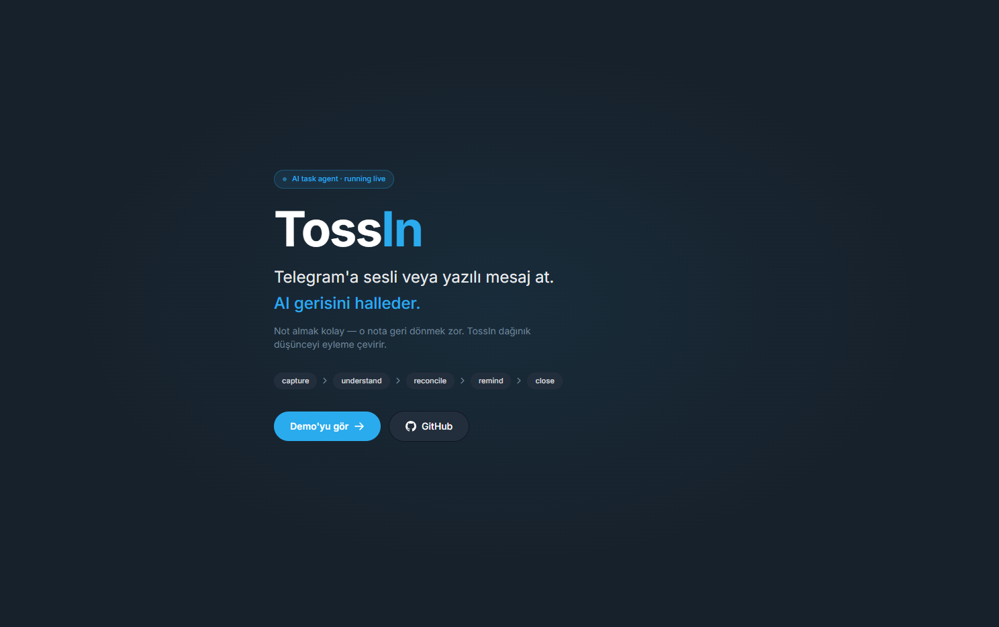
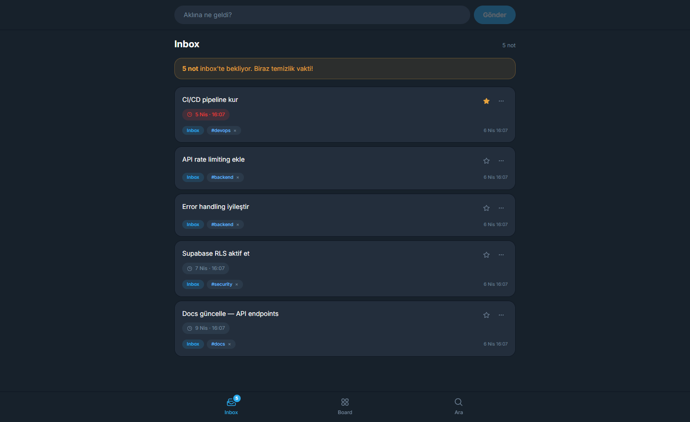
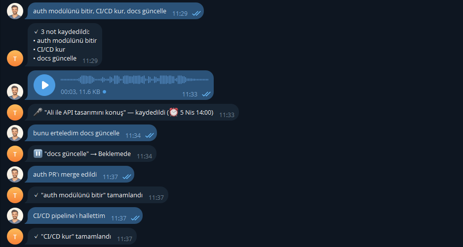
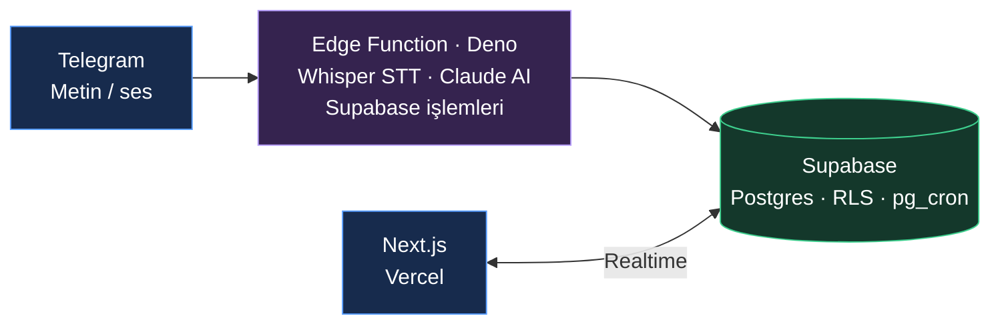

<div align="center">

# TossIn

**Toss it. Review it. Keep it.**

Aklınıza gelenleri Telegram'a atın, AI sizin için sınıflandırsın, web'de Kanban'da yönetin.

[](https://toss-in-v3xp.vercel.app)


[Live demo](https://toss-in-v3xp.vercel.app) · [Telegram bot](https://t.me/tossinBot) · [Issues](https://github.com/rudukan/TossIn/issues)

</div>

---

## Nedir?

TossIn, kişisel bir görev/not ajanı. Klasik to-do uygulamalarından farkı: **Telegram üzerinden konuşma diliyle** çalışıyor.

> "fatura öde" yaz → inbox'a düşer
> "fatura ödendi" yaz → AI önceki notu bulur, Bitti'ye taşır
> "yarın saat 10'da Ahmet ile toplantı" yaz → otomatik hatırlatma kurulur

Sesli mesaj, çoklu görev, "bugün ne var?" sorgusu, gecikmiş hatırlatmalar — hepsi Telegram'dan. Web tarafı ise sakin bir Kanban board.

## Özellikler

- 💬 **Telegram'dan capture** — yazılı veya sesli mesaj at, AI sınıflandırsın
- 🧠 **Semantik eşleştirme** — "X yapıldı" mesajı, mevcut "X yap" görevini bulup Bitti'ye taşır
- 🎯 **4-kolonlu Kanban** — Inbox / Yapılıyor / Beklemede / Bitti, drag & drop
- ⏰ **Akıllı hatırlatmalar** — pg_cron + Edge Function ile otomatik bildirim
- 🔍 **Türkçe full-text search** — Postgres `tsvector` ile
- 🔐 **Auth + RLS** — Supabase Auth, satır-bazlı yetki
- ⚡ **Realtime sync** — bir cihazda yapılan değişiklik diğerlerinde anında

## Görseller

<div align="center">

| Landing | Inbox | Board | Telegram |
|---------|-------|-------|----------|
|  |  | .png>) |  |

</div>

## Mimari



## Stack

| Katman | Teknoloji |
|--------|-----------|
| Frontend | Next.js 16 (App Router), React 19, TypeScript, Tailwind v4 |
| Backend | Supabase (Postgres + Auth + Realtime + Edge Functions + pg_cron) |
| AI | Claude Haiku 4.5 (sınıflandırma), Groq Whisper Large v3 (ses-yazı) |
| Bot | Telegram Bot API |
| Deploy | Vercel (web), Supabase (edge functions) |

## Lokal kurulum

```bash
git clone https://github.com/rudukan/TossIn.git
cd TossIn
npm install
cp .env.example .env.local
# .env.local'ı kendi Supabase bilgilerinle doldur
npm run dev
```

`.env.local`:
```
NEXT_PUBLIC_SUPABASE_URL=https://your-project.supabase.co
NEXT_PUBLIC_SUPABASE_ANON_KEY=your-anon-key
```

Telegram bot ve Edge Functions için ayrıca Supabase secrets gerekiyor — detay için [`.env.example`](.env.example).

## Yapılacaklar

- [ ] Multi-user Telegram (`/connect` flow)
- [ ] PWA (mobil home screen)
- [ ] Sabah özeti + gün sonu cron'ları
- [ ] Recurring tasks
- [ ] Multi-source capture (WhatsApp, e-posta)

## Lisans

MIT

---

<div align="center">

Bir kişisel proje — geri bildirim ve PR'lar memnuniyetle kabul edilir.

Kuran: [@rudukan](https://github.com/rudukan)

</div>
